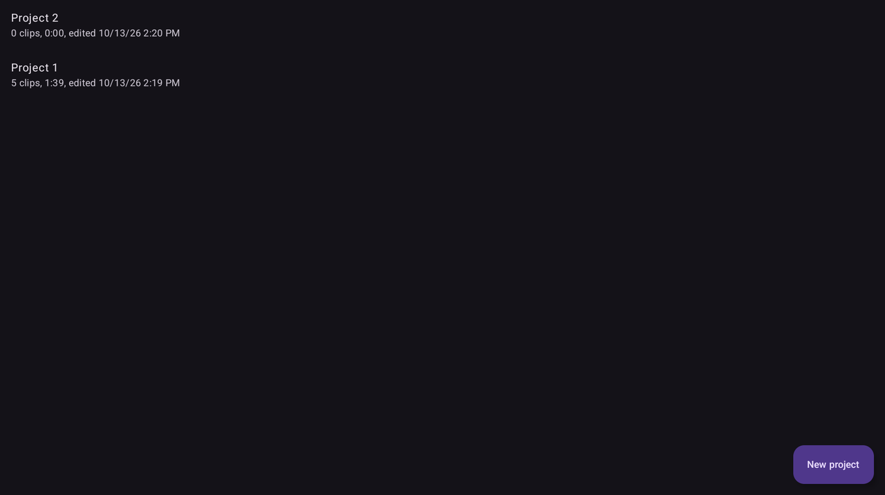
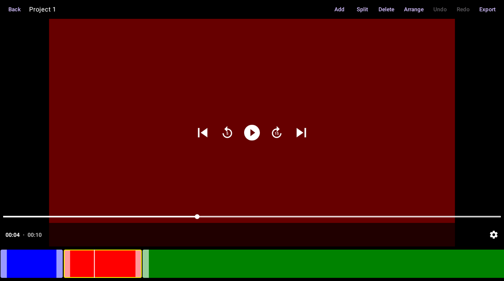
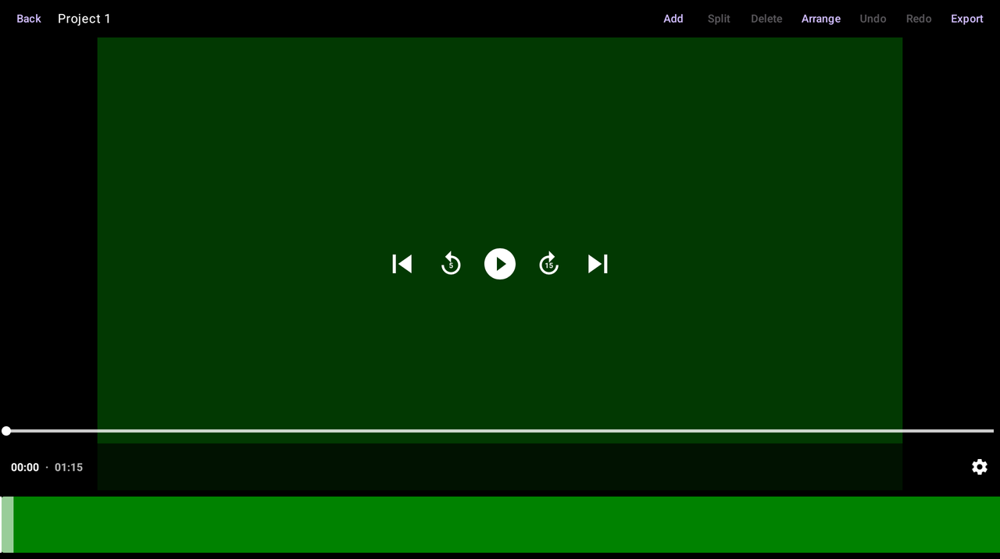
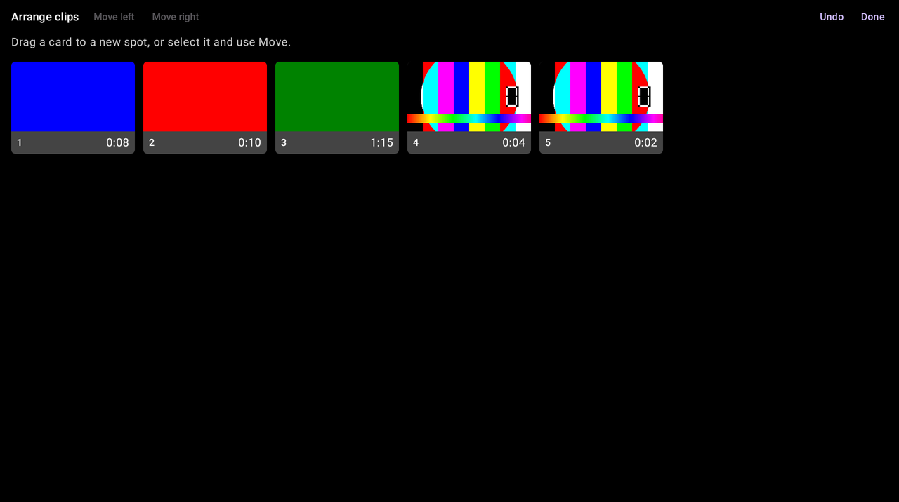
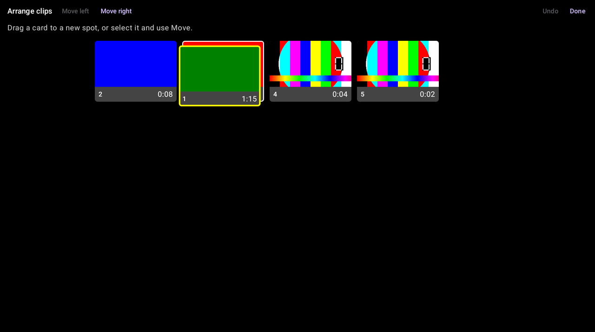
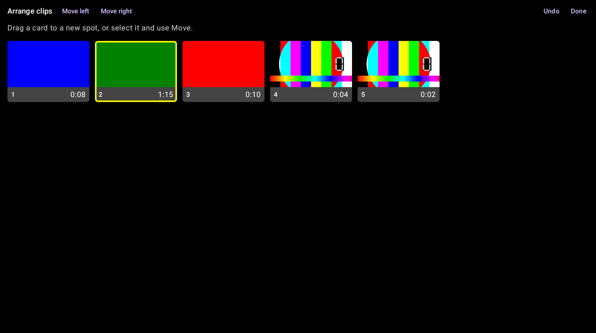
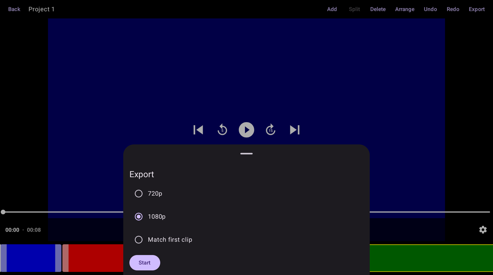
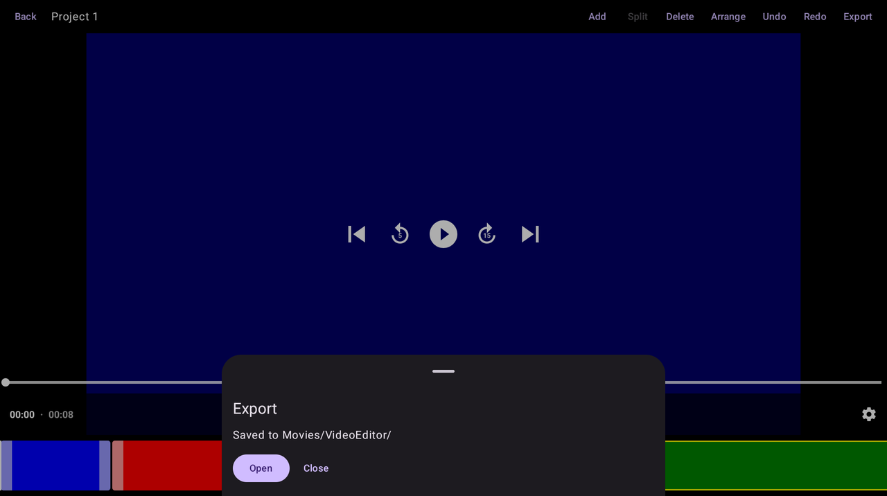

# Using Video Editor

This guide walks through the app on the Fire Max 11 (landscape). For installing, see the [README](../README.md).

## Projects

The home screen lists your projects, most recently edited first, with the clip count, total length and when you last edited each one.

- Tap **New project** to start one.
- Tap a project to open it.
- Press and hold a project to rename it or delete it. Deleting a project never touches your original videos.

Projects save automatically while you edit. There is no Save button.

## The editor

The editor has three parts:

- **Toolbar** (top): Back, the project name, then **Add**, **Split**, **Delete**, **Arrange**, **Undo**, **Redo** and **Export**. Buttons are grey when they can't be used yet.
- **Preview** (middle): plays the whole project. Tap it to show the play controls.
- **Timeline** (bottom): one block per clip, in order. A clip's width matches its length, so long clips are wide. The white line is the playhead.

### Add clips

Tap **Add** and pick one or more videos. To pick several, press and hold the first video, then tap the others, then tap **Select**. New clips go at the end. You can add more at any time.

### Select, trim, split and delete

- **Select**: tap a clip on the timeline. It gets a yellow border, and the playhead jumps to where you tapped.
- **Trim**: drag the light handle on a clip's left or right edge to cut the start or the end.
- **Split**: move the playhead to the spot you want, then tap **Split**. The clip becomes two clips.
- **Delete**: select a clip and tap **Delete**.

**Undo** and **Redo** step back and forward through every change, trims and reorders included.

## Reorder clips with Arrange

On the timeline, a long clip can fill the whole screen, which makes it hard to see where a clip would go:

**Arrange** solves this. Tap **Arrange** in the toolbar (it needs at least two clips). Every clip shows as a same-size card with its position number and its length, so all your clips fit on screen however long they are.

There are two ways to move a clip:

**Drag a card.** Put your finger on a card and drag it. A white frame shows the spot where it will land. Let go to drop it there. The other cards shift to make room.

**Use the Move buttons.** Tap a card to select it (yellow border), then tap **Move left** or **Move right** to shift it one place. This is the easier option if dragging is fiddly.

Each move is one step for **Undo**, and the **Undo** button works inside Arrange too. Tap **Done** (or the back button) to return to the editor. The timeline shows the new order.

You can also reorder on the timeline itself by pressing and holding a clip and then dragging it. That works best with short clips.

## Export

Tap **Export**, choose a quality, and tap **Start**.

- **720p** and **1080p** set the size of the finished video.
- **Match first clip** uses the size and shape of your first clip, but never larger than 1080p.

You can leave the app while it works. A notification shows "Exporting video" with progress, then "Export complete" (or "Export failed" with the reason).

The video is saved to **Movies/VideoEditor/** on the tablet. Tap **Open** to play it, or find it later in the Photos or Files app.

## Missing clips

If an original video is moved or deleted, its clip turns red, and preview and export are turned off. Delete the red clips (or add the video again) to continue.
